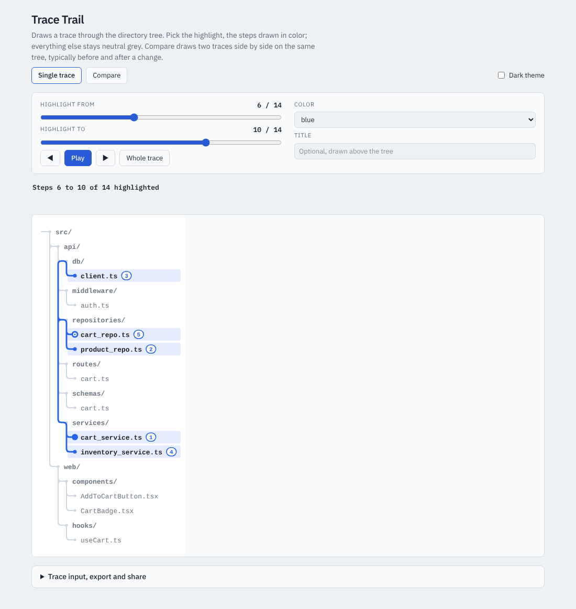

# 🌲 Trace Trail

Draws the route a trace takes through a directory tree, with one highlighted interval of steps. Use it to show which files a piece of behaviour touches, and in what order.



## 🌐 Web app

Try it at **https://realjohndoe.github.io/tracetrail/**. Paste a trace, pick the highlight, color and theme, compare two traces side by side, and export the result as SVG or PNG. **Copy share link** gives a URL that restores the exact view, and **Copy CLI command** and **Download trail spec** give you the same image from the [CLI](#-cli) ([ADR-0011](./docs/adr/0011-share-links-are-a-deflate-compressed-trail-spec-in-the-url-fragment.md)).

## 💻 CLI

`render` draws a trace file as an SVG (or PNG):

```sh
tracetrail render TRACE [--title T] [--color C] [--highlight N|A-B] [--dark-mode] [--png] -o out.svg
tracetrail render --spec trail.json [--dark-mode] [--png] -o out.svg
```

- `TRACE`: a trace file, one step per line (`-` reads stdin).
- `--title T`: title above the tree.
- `--color C`: `blue` (default), `red`, `green`, `orange`, `purple` or `gray`.
- `--highlight N|A-B`: 1-based step numbers to draw in color, e.g. `3` or `2-5`. Default: the whole trace.
- `--spec FILE`: a trail spec as JSON (`{"panels": [{"trace": "...", "title": "...", "color": "red", "highlight": [2, 5]}]}`) instead of `TRACE` and the flags above.
- `--dark-mode`: draw the dark theme instead of the light one ([ADR-0006](./docs/adr/0006-svg-first-system-monospace-named-colors.md)). With `--spec` it overrides the spec's `theme`. The web app has the same switch as **Dark theme**, for both single traces and comparisons, and a trail spec can set `"theme": "dark"`.
- `--png`: write a PNG instead of an SVG; an output path ending in `.png` does the same. The conversion uses `@resvg/resvg-js` and needs no browser, but it needs a monospace font installed (for example DejaVu Sans Mono or Liberation Mono in a bare container image). Without one the command exits with an error instead of writing a PNG without text ([ADR-0010](./docs/adr/0010-png-is-rendered-with-resvg-js-and-needs-an-installed-monospace-font.md)). PNG bytes depend on the installed fonts, so only SVG output is byte-for-byte reproducible.
- `-o, --output FILE`: where to write the image (required).

`compare` draws two trace files as one comparison: two panels side by side on the same tree, built from the paths of both traces, so every path sits at the same height in both panels and paths only one trace visits stay neutral grey in the other:

```sh
tracetrail compare LEFT RIGHT \
  [--left-title T] [--left-color C] [--left-highlight N|A-B] \
  [--right-title T] [--right-color C] [--right-highlight N|A-B] \
  [--dark-mode] [--png] -o out.svg
```

Titles default to `before` and `after` (`""` for none); both sides default to the same color. A trail spec with two panels renders the same image through `render --spec`. `--dark-mode` and `--png` work as for `render`. The web app's Compare mode builds the same trail spec.

Invalid input (unknown color, malformed or out-of-range highlight, empty trace, bad spec) prints a message to stderr and exits 1; usage errors exit 2. `tracetrail --help` lists everything with examples.

## 🤖 Trail images in pull requests

Trace Trail ships an agent skill, `skills/tracetrail-pr/`, that adds trail images to pull request descriptions. To have agents use it in another repo, add a sentence like this to that repo's `CLAUDE.md` or `AGENTS.md`:

> After opening a pull request, or pushing changes to one, use the `tracetrail-pr` skill to add or refresh trail images in its description.

## 🛠️ Contributing

Want to work on the code? See [CONTRIBUTING.md](./CONTRIBUTING.md). The vocabulary is in [GLOSSARY.md](./GLOSSARY.md) and the decisions behind the design are in [docs/adr/](./docs/adr/).
